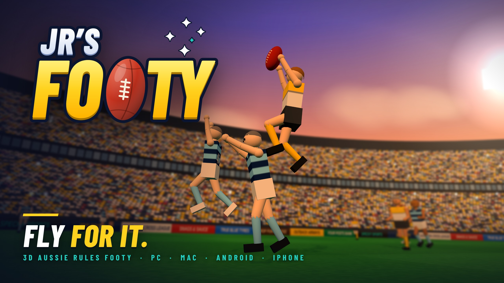
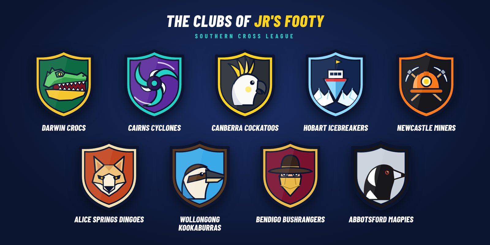

# JR's Footy 🏉



A fast, fun 3D Aussie rules football game that runs on **Windows, macOS, Android and iPhone/iPad** from a single link — and installs like an app on all of them.

Take marks, snap goals, line up set shots, lay tackles and fly for screamers in a packed stadium, with a full 18-a-side match engine, nine clubs and a season mode.

## Features

- **Full Aussie rules match engine** – 18 v 18, centre bounces and ruck contests, marks, handballs, tackles and holding the ball, set shots, behinds, kick-ins, boundary throw-ins, out on the full, four quarters and after-the-siren kicks.
- **Pick-up-and-play controls** – one stick and three buttons. Aim assist picks out team-mates and the goals, a ring shows where the ball will land, and the AI helps your player along when you let go of the stick.
- **3D stadium** – day, twilight and night matches, real-time shadows, packed grandstands that leap up for goals, live scoreboards, confetti, cinematic set-shot and goal cameras.
- **Sound** – a crowd that rises and falls with the play, umpire's whistle, the siren, leather on boot, post "doinks" and a brass-band menu tune (all synthesised, no downloads).
- **Game modes** – Quick Match, plus a home-and-away **Season** with a ladder, bye weeks and a Grand Final. Three difficulty levels and 2, 3 or 5 minute quarters.
- **Works everywhere** – keyboard, touch screen or gamepad. Installable, full-screen and playable offline.

The clubs and league (the *Southern Cross League*) are original creations — this is an independent game and isn't affiliated with any real league or club.

## Installing

JR's Footy is a *progressive web app*: there's nothing to download from a store. Open the game's web address once, then:

| Device | How to install |
| --- | --- |
| **Windows PC** | Open the link in **Chrome** or **Edge** → click the install icon at the right of the address bar (or the in-game **Install App** button). It then launches from the Start menu / desktop. |
| **Mac** | **Chrome / Edge:** click the install icon in the address bar. **Safari:** *File → Add to Dock*. |
| **Android** | Open the link in **Chrome** → tap **Install App** in the game (or ⋮ menu → *Install app*). |
| **iPhone / iPad** | Open the link in **Safari** → tap **Share** → **Add to Home Screen**. |

Once installed it opens full screen, in landscape, and works without an internet connection. You can also just play it in the browser without installing anything.

## Controls

| | Keyboard | Touch | Gamepad |
| --- | --- | --- | --- |
| Move | `W A S D` / arrow keys | Left thumb (stick appears where you touch) | Left stick |
| Kick · Mark · Tackle | `Space` / `J` | Big red button | `A` |
| Handball · Switch player | `E` / `K` | Blue button | `B` / `X` |
| Sprint | `Shift` / `L` | Green button | `RT` |
| Pause | `Esc` / `P` | ❚❚ | `Start` |
| Menus | Arrow keys, `Space` to select, `Esc` to go back | Tap | D-pad or stick, `A` to select, `B` to go back, `Start` for the main button |

- **Kicking:** hold *Kick* to power up, aim with the stick, release. A light tap is a short pass; full power is a long bomb or a shot at goal. The blue ring shows which team-mate you'll hit.
- **Marking:** run to the white ring where the ball will land and press *Mark* to fly for it. Catch a kick of 15 m or more and you get a free kick.
- **Set shots:** mark within range and press *Kick* to line up — then stop the needle in the green.
- **Defending:** press *Tackle* next to the ball carrier; *Switch* jumps to your closest player. Catch them holding the ball and the free kick is yours.

## Updates

There's nothing to reinstall. Each time the game is opened with an internet connection it quietly checks for a newer version. If one is found while you're still on the title screen, the game refreshes itself within a few seconds; if you've already started using the menus, an **Update ready** button appears instead (and the next launch has the new version either way). The version number is shown in the corner of the title screen.

## Putting it online

The game is a plain static website (no build step), so any static host works.

**GitHub Pages** (easiest from this repository):

1. On GitHub open **Settings → Pages**.
2. Under *Build and deployment* choose **Deploy from a branch**, pick the branch that contains the game and the **/ (root)** folder, then **Save**.
3. After a minute the game is live at `https://<your-username>.github.io/<repository-name>/` — that's the link to open and install on every device.

> GitHub Pages needs a public repository on GitHub's free plan (private repositories require a paid plan). If you'd rather keep the code private, drag the project folder onto [Netlify Drop](https://app.netlify.com/drop) or use Cloudflare Pages — both are free and give you a link in seconds.

## Running it on your own computer

You need [Node.js](https://nodejs.org) 18 or newer.

```bash
npm start
```

Then open <http://localhost:8080>. (Any static file server works too, e.g. `python3 -m http.server`.)

## For developers

```
index.html            page shell: canvas, HUD and menus
css/style.css         all styling
src/main.js           game states, frame loop, reactions to match events
src/sim/match.js      the rules: ball physics, possession, contests, scoring, quarters
src/sim/ai.js         team structure and player decision making
src/gfx/              three.js renderer: stadium, players, textures, cameras, effects
src/audio.js          Web Audio synthesiser (crowd, whistle, siren, music)
src/input.js          keyboard, touch and gamepad
src/ui.js             menus, HUD, minimap, summaries
src/season.js         season fixtures and ladder
src/emblems.js        club crests (drawn as SVG)
sw.js                 service worker (offline + install)
tools/sim-test.mjs    headless match simulator used for testing and balancing
```

The simulation is independent of the renderer, so whole matches can be played headlessly:

```bash
npm test
```

runs AI v AI games and games with a scripted "player" at each difficulty, checking that matches complete cleanly and printing scoring and balance statistics.

All graphics are generated in code (procedural models and canvas-painted textures) and all audio is synthesised, so the entire game is about 1 MB.

## Artwork

Everything in [`branding/`](branding) is original and ready to use on a store page, website or social post:

| File | What it is |
| --- | --- |
| `logo.svg` / `logo.png` | The JR's Footy logo on a transparent background (vector, and a 2000 px PNG). Works on dark, light and photo backgrounds. |
| `logo-tagline.svg` / `logo-tagline.png` | The logo with the "Southern Cross League" line underneath. |
| `icon.svg` / `icon-1024.png` | The app icon. `icon-maskable.svg` has extra padding for Android's shaped icons. The sizes the game itself uses live in `icons/`. |
| `hero.jpg` | 2560 × 1440 key art with logo and tagline. |
| `hero-clean.jpg` | The same artwork with no logo or text, for your own layouts. |
| `social-card.jpg` | 1200 × 630 card for link previews. |
| `clubs/*.svg` | Each club's crest as a vector file, plus `clubs/crests.png` showing all nine together. |

The hero image is rendered with the game's own 3D engine, so it shows exactly what players get.



The crests are drawn in code (`src/emblems.js`). After changing one, run `node tools/export-crests.mjs` to refresh the files in `branding/clubs/`.

## Credits

- 3D rendering by [three.js](https://threejs.org) (MIT licence) — see `vendor/three.LICENSE`.
- Typeface: [Barlow Condensed](https://github.com/jpt/barlow) (SIL Open Font Licence) — see `fonts/OFL-LICENSE.txt`.
